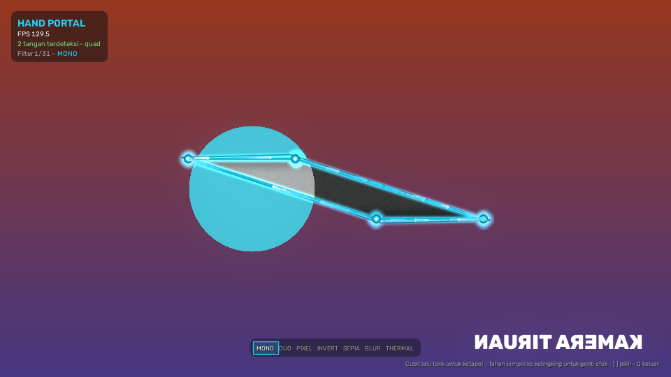
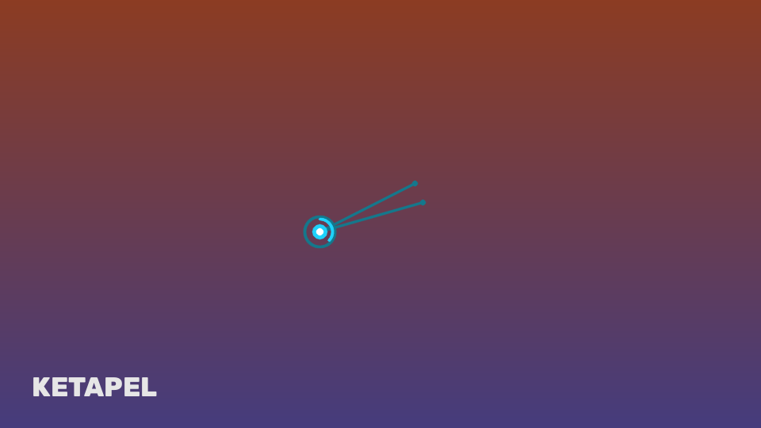

# Hand Portal

Filter kamera interaktif: dua tangan membentuk bingkai di udara, dan efek
gambar muncul hanya di dalam bingkai itu. Dibuat dengan MediaPipe dan OpenCV,
berjalan lokal tanpa internet setelah model terunduh.



Terinspirasi dari tren filter portal di TikTok, dengan beberapa hal yang
sengaja diperbaiki:

- Pergantian filter harus **ditahan** dulu, jadi tidak melompat saat tangan
  sekadar lewat.
- Portal dihaluskan dan distabilkan, jadi tidak bergetar mengikuti noise
  deteksi.
- Ada **ketapel**: cubit dan tarik, peluru meluncur lalu pecah berhamburan.
- **31 filter**, dengan tepi portal bergradasi dan partikel yang mengalir.

## Kebutuhan

- Python 3.10 atau lebih baru
- Webcam
- macOS, Linux, atau Windows

## Menjalankan

**Cara paling gampang di macOS:** buat bundle-nya sekali, lalu klik dua kali
dari Finder.

```sh
./tools/build_app.sh
open "Hand Portal.app"
```

Bundle itu sudah mendeklarasikan izin kamera, jadi macOS langsung memberi
dialog izin yang benar. Kalau pertama kali dibuka, macOS mungkin menolak
karena aplikasi belum ditandatangani: klik kanan lalu **Open**, atau buka
**System Settings → Privacy & Security** dan klik **Open Anyway**.

Lewat terminal:

```sh
./run.sh
```

Skrip itu membuat venv, memasang dependensi, mengunduh model, lalu membuka
jendela kamera. Kalau mau manual:

```sh
python3 -m venv .venv
source .venv/bin/activate
pip install -r requirements.txt
python main.py
```

Model diunduh otomatis saat pertama dijalankan ke folder `models/`. Untuk
mengunduh ulang:

```sh
python main.py --download-models
```

### Kalau kamera tidak bisa dibuka

Jalankan pemeriksaan cepat:

```sh
python main.py --probe-camera
```

Perintah itu hanya membuka kamera, mengambil satu frame, lalu keluar. Hasilnya
memisahkan dua penyebab yang mirip: izin sistem yang belum diberikan, atau
kamera yang sedang dipakai aplikasi lain.

Di macOS, izin kamera melekat pada aplikasi yang menjalankan Python, bukan
pada Python-nya. Menjalankan `./run.sh` dari Terminal berarti Terminal yang
harus diberi izin di **System Settings → Privacy & Security → Camera**.
`Hand Portal.app` menghindari masalah itu karena dia membawa deklarasi
izinnya sendiri.

## Cara pakai

**Portal persegi.** Letakkan ujung jempol dan ujung telunjuk kedua tangan di
depan kamera. Empat ujung jari itu membentuk bingkai, dan filter hanya muncul
di dalamnya.

**Ketapel.** Cubit jempol dan telunjuk satu tangan, tarik ke belakang, lalu
lepas. Semakin jauh tarikan, semakin besar kekuatannya. Saat lepas, peluru
meluncur ke arah berlawanan dan pecah berhamburan ketika sampai atau keluar
layar. Bola yang sedang ditarik membesar dan cincin di sekelilingnya penuh
kalau tarikan sudah maksimal.

| Sedang ditarik | Peluru buyar |
| --- | --- |
|  |  |

**Ganti filter.** Tahan gestur ini sekitar 0,8 detik:

- rapatkan jempol dan kelingking satu tangan,
- atau rapatkan ujung telunjuk kedua tangan.

Filter juga berganti sendiri setiap 9 detik. Tekan `A` untuk mematikan atau
menyalakannya lagi. Tombol keyboard bisa dipakai kapan saja:

| Tombol | Fungsi |
| --- | --- |
| `[` `]` | filter sebelumnya / berikutnya |
| `1` sampai `9` | lompat ke filter nomor itu |
| `A` | ganti filter otomatis |
| `Space` | simpan foto ke `captures/` |
| `R` | mulai / berhenti merekam mp4 |
| `H` | sembunyikan / tampilkan panel |
| `P` | partikel tepi portal |
| `L` | kerangka tangan |
| `F` | layar penuh |
| `M` | efek cermin |
| `Q` atau `Esc` | keluar |

## Daftar filter

31 efek, berurutan sesuai korsel di layar:

`MONO`, `DUO`, `PIXEL`, `INVERT`, `SEPIA`, `BLUR`, `THERMAL`, `SKETCH`,
`GLITCH`, `NEON`, `GALAXY`, `MIRROR`, `HALFTONE`, `XRAY`, `VAPOR`, `EDGES`,
`POSTER`, `DREAM`, `GRAIN`, `MATRIX`, `COMIC`, `AQUAREL`, `NIGHT`,
`BLUEPRINT`, `HOLO`, `SUNSET`, `EMBOSS`, `CHROME`, `LOMO`, `INFRARED`,
`CONFETTI`.

Untuk melihat daftar beserta penjelasannya dari terminal:

```sh
python main.py --list-filters
```

## Memilih kamera

macOS kadang menampilkan kamera iPhone (Continuity Camera) sebagai perangkat
tambahan, dan urutannya bisa berubah. Aplikasi ini memilih kamera bawaan
laptop secara otomatis. Untuk melihat daftar dan memilih sendiri:

```sh
python main.py --list-cameras
python main.py --camera 1
```

## Pilihan baris perintah

```sh
python main.py --camera 1 --width 1920 --height 1080
python main.py --no-bloom --no-particles     # lebih ringan
python main.py --record demo.mp4             # langsung merekam
python main.py --auto-cycle 4                # ganti filter tiap 4 detik
python main.py --auto-cycle 0                # matikan ganti otomatis
python main.py --bones                       # tampilkan garis kerangka
python main.py --list-filters                # lihat daftar filter
python main.py --list-cameras                # lihat kamera yang tersedia
```

Semua opsi ada di `python main.py --help`.

## Kalau terasa berat

Turunkan resolusi dulu (`--width 960 --height 540`), lalu matikan bloom
(`--no-bloom`) dan partikel (`--no-particles`). Filter berlatar seperti galaxy
dan matrix paling mahal karena menjalankan segmenter, jadi kalau patah-patah
hindari keduanya.

## Struktur

```
main.py                  titik masuk dan argumen CLI
Hand Portal.app          peluncur macOS dengan deklarasi izin kamera
run.sh                   siapkan venv lalu jalankan
hand_portal/
  app.py                 loop kamera, tombol, perekaman
  tracker.py             pembungkus MediaPipe (tangan dan segmenter)
  gestures.py            portal dari jari, gestur ganti filter
  slingshot.py           ketapel: tarik, lepas, peluru, pecahan
  filters.py             kumpulan efek gambar (31 filter)
  render.py              komposisi portal, kerangka, glow
  hud.py                 panel informasi dan toast
  recorder.py            rekam video dan simpan foto
  assets.py              unduhan model
  config.py              setelan dan palet warna
  cameras.py             memilih kamera bawaan, bukan kamera HP
  contracts.py           tipe data bersama antar modul
tools/selftest.py        uji semua filter tanpa kamera
tools/appcheck.py        uji integrasi app.py tanpa kamera
tools/slingshot_check.py uji ketapel tanpa kamera
tools/launcher.c         sumber peluncur app bundle
```

## Uji tanpa kamera

```sh
.venv/bin/python tools/selftest.py
```

Perintah itu menjalankan semua filter pada frame buatan, menyimpan contoh
hasilnya ke `captures/`, dan melaporkan filter yang gagal atau lambat. Berguna
setelah mengubah kode kalau sedang tidak mau duduk di depan webcam.

## Izin kamera di macOS

Kalau muncul pesan kamera tidak bisa dibuka, buka **System Settings → Privacy
& Security → Camera** dan nyalakan untuk aplikasi yang menjalankan Python
(Terminal, iTerm, atau VS Code). Aplikasi perlu ditutup dan dibuka lagi
setelah izin diberikan.

`Hand Portal.app` adalah cara yang paling tidak merepotkan: dia punya
deklarasi izin sendiri, jadi yang muncul di daftar Camera adalah namanya
sendiri, bukan nama terminal.
